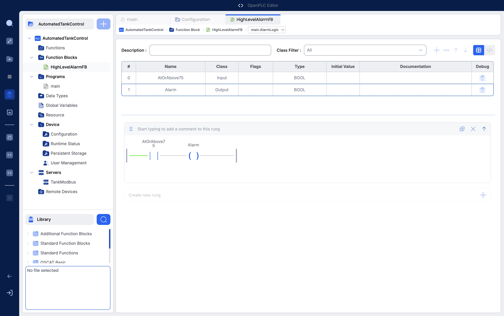
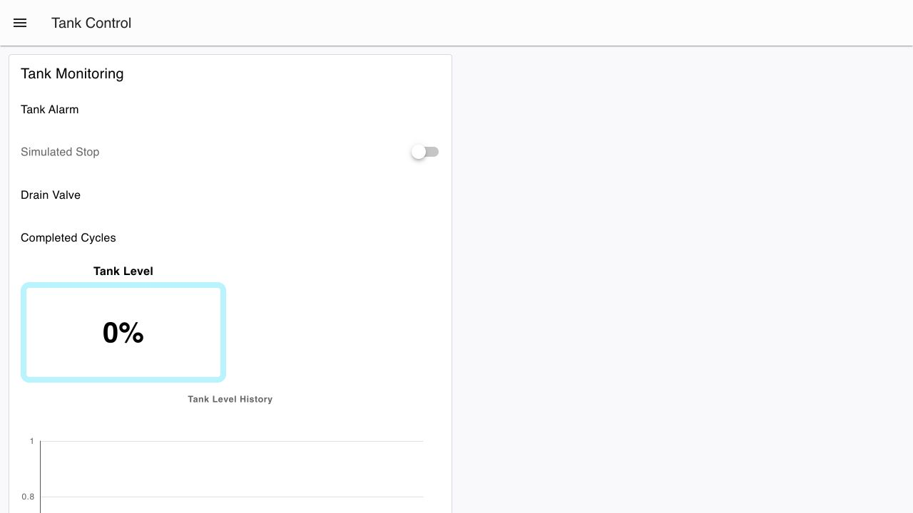

# Industrial PLC Tank Control

A software simulation of an automated tank system built with OpenPLC and Node-RED. The project demonstrates PLC sequencing, alarms, Modbus TCP communication, and a web-based operator dashboard without requiring physical hardware.

## Screenshots

### OpenPLC project and high-level alarm logic

### Node-RED operator dashboard

## What it does

The PLC simulates a tank that automatically fills from 20% to 80%, drains back to 20%, and repeats. It controls simulated fill and drain valves, counts completed cycles, and activates a high-level alarm when the tank reaches 75%.

The Node-RED dashboard displays the tank level, level history, valve states, alarm state, and cycle count. It also provides controls for automatic operation and a simulated stop command.

## How it works

1. OpenPLC runs the tank sequence and updates the simulated inputs and outputs.
2. Structured Text controls the filling, draining, stopping, and cycle-counting logic.
3. A Ladder Logic function block controls the high-level alarm.
4. OpenPLC exposes the tank data and commands through Modbus TCP.
5. Node-RED reads the PLC data and sends operator commands through the dashboard.

## Tools and languages

- **Structured Text (IEC 61131-3)** — main PLC control program
- **Ladder Logic** — high-level alarm function block
- **JavaScript** — Node-RED data handling and dashboard logic
- **OpenPLC Editor and Runtime** — PLC development and execution
- **Node-RED and Dashboard 2.0** — operator interface
- **Modbus TCP** — communication between the PLC and dashboard
- **Docker and Colima** — local OpenPLC Runtime environment
- **JSON** — project, device, Modbus, and Node-RED configuration

This project is a software-only educational simulation and does not control physical equipment.
