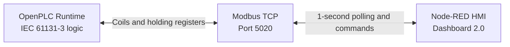

# Industrial PLC Tank Control

A hardware-free industrial automation project that combines IEC 61131-3 PLC logic, Modbus TCP, and a Node-RED HMI. The simulated process automatically fills a tank to 80%, drains it to 20%, counts completed cycles, and exposes operator controls and alarms through a web dashboard.

## Engineering highlights

- Structured Text state machine for the fill, drain, idle, and stop behavior
- Ladder Logic function block for the high-level alarm
- Explicit Modbus address map for commands, outputs, and telemetry
- Node-RED Dashboard 2.0 HMI with a tank gauge, trend chart, cycle counter, valve states, alarm state, and operator switches
- Feedback polling so dashboard controls reflect the PLC's current state
- Hardware-independent setup suitable for development and demonstration on a laptop

## Architecture



The tested development environment used OpenPLC Runtime v4 in Docker/Colima on Apple Silicon. The design is not tied to physical I/O or a specific PLC vendor.

## Control sequence

1. With `AutoRun` enabled, the controller selects filling unless the tank is already at its upper limit.
2. The fill valve raises the simulated level from 20% to 80%.
3. At 80%, the controller closes the fill valve and begins draining.
4. At 20%, it closes the drain valve, increments the cycle counter, and begins another fill cycle.
5. Disabling `AutoRun` or enabling `StopCmd` puts the sequence in idle and closes both valves.
6. The ladder function block raises `HighLevelAlarm` whenever the tank level is at least 75%.

## Modbus map

Addresses are zero-based. The mapping is configured in [`devices/servers/TankModbus.json`](devices/servers/TankModbus.json).

| Modbus address | PLC variable | Direction | Purpose |
| --- | --- | --- | --- |
| Holding register 0 | `%QW0` | PLC → HMI | Tank level (%) |
| Holding register 1 | `%QW1` | PLC → HMI | Completed cycle count |
| Coil 0 | `%QX0.0` | PLC → HMI | Fill valve state |
| Coil 1 | `%QX0.1` | PLC → HMI | Drain valve state |
| Coil 2 | `%QX0.2` | PLC → HMI | High-level alarm |
| Coil 8 | `%MX0.0` | HMI → PLC | Automatic mode command |
| Coil 9 | `%MX0.1` | HMI → PLC | Simulated stop command |

## Repository layout

```text
.
├── devices/                    OpenPLC target and Modbus configuration
├── node-red/
│   └── tank-dashboard.json     Importable Node-RED flow
├── pous/
│   ├── function-blocks/        Ladder Logic alarm function block
│   └── programs/               Structured Text control program
├── scripts/
│   └── validate-project.mjs     Dependency-free consistency checks
├── project.json                OpenPLC Editor project definition
└── README.md
```

Generated OpenPLC build output is intentionally excluded from version control. OpenPLC Editor recreates it from the project sources.

## Run locally

### Prerequisites

- OpenPLC Editor and OpenPLC Runtime v4
- Node.js and Node-RED
- `node-red-contrib-modbus` 5.62.1
- `@flowfuse/node-red-dashboard` 1.36.1

### PLC

1. Open `project.json` in OpenPLC Editor.
2. Review the runtime target in `devices/configuration.json` and build the project.
3. Deploy it to an OpenPLC Runtime v4 instance. The tested local runtime endpoint was `127.0.0.1:8443`.
4. Start the PLC and confirm that its Modbus TCP server is listening on port `5020` with Unit ID `1`.

### HMI

1. Start Node-RED.
2. Import `node-red/tank-dashboard.json` and deploy the flow.
3. Confirm that the Modbus client points to `127.0.0.1:5020`.
4. Open `http://localhost:1880/dashboard/tank-control`.
5. Enable **Automatic Mode** and observe the tank level, valve states, trend, alarm, and cycle count.

## Validate the repository

Run the dependency-free project check with Node.js:

```bash
node scripts/validate-project.mjs
```

It parses every JSON asset, checks Node-RED IDs and wiring, confirms the dashboard's Modbus reads match the PLC server configuration, and verifies that the documented PLC variables remain mapped in the Structured Text program.

## Verification

The following were verified during development:

- The PLC project compiled and deployed to OpenPLC Runtime v4.
- Tank level and cycle registers changed over Modbus TCP.
- The repository's Node-RED export loads successfully with Node-RED 5 and Dashboard 2.0.
- Dashboard reads and writes use the same Unit ID and address map as the PLC configuration.
- The exported flow contains no credentials or environment-specific secrets.

For a quick command-line check, read the two holding registers with `mbpoll`:

```bash
mbpoll -m tcp -p 5020 -a 1 -t 4:int16 -0 -r 0 -c 2 -1 127.0.0.1
```

Read the alarm coil with:

```bash
mbpoll -m tcp -p 5020 -a 1 -t 0 -0 -r 2 -c 1 -1 127.0.0.1
```

## Scope and safety

This repository is an educational software simulation. `StopCmd` is a process-control input, not a safety-rated emergency stop. The project must not be used to control physical equipment without an appropriate hardware design, safety analysis, and independent protective systems.
